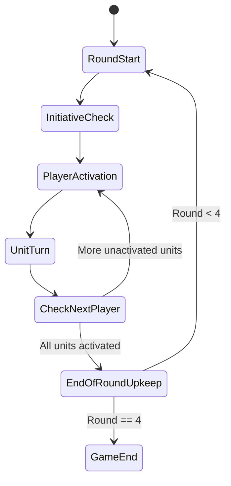
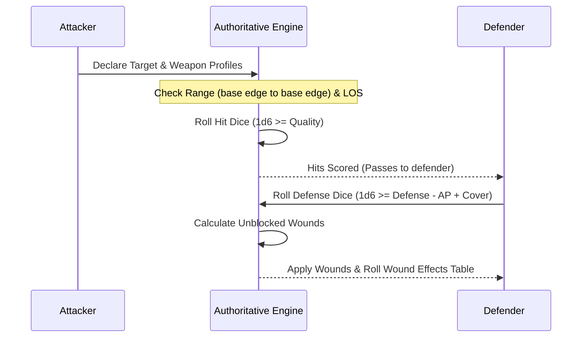

# SkirmishLab Rules Engine Specification

> **Clean-Room Mechanical Specification**
> This document specifies the complete first-principles mathematical model, state machine, and trait resolution engine for SkirmishLab tabletop skirmish simulation. It aligns 1:1 mechanically with standard 3.5 skirmish rules (Grimdark Future: Firefight compatible) using distinct, independent terminology and schemas.

---

## 1. Core Mathematical Axioms

### 1.1 Competence Tests (D6 Metric)
All unit capabilities test against a six-sided die (1d6) relative to an intrinsic Quality threshold ($Q \in [2, 6]$):
$$\text{Success} \iff \text{Roll} \ge Q$$

- **Natural 6 (Critical Success):** An unmodified roll of 6 always succeeds, regardless of negative situational modifiers.
- **Natural 1 (Critical Failure):** An unmodified roll of 1 always fails, regardless of positive situational modifiers.

### 1.2 Armor & Protection Tests (Defense)
Defense tests are rolled by defending units per incoming hit against an Armor/Defense threshold ($D \in [2, 6]$):
$$\text{Blocked} \iff (\text{Roll} + \text{CoverMod} - \text{AP}) \ge D$$
- An unblocked hit causes exactly **1 wound** (unless modified by damage traits like `Deadly(X)`).

---

## 2. Battlefield Geometry & Setup

### 2.1 Spatial Dimensions & Coherency
- **Table Dimensions:** Standard $48" \times 48"$ ($4' \times 4'$) playing area, or compact custom formats with at least **24" separation** between opposing deployment lines.
- **Deployment Zones:** Opposing table edges up to **12" depth**, shallower on small tables so the two zones are always at least **24"** apart (e.g. 3" deep on a 30"-deep table). The game board is the map's own size (the default battlefield is 48" × 48"; boards run from 24" to 72" per side, and maps saved at 44" × 30" keep that size).
- **Measuring rule (base edges):** every distance between two models is measured between the closest points of their bases (centre distance minus both base radii; bases are 1" wide, radius 0.5"), and distances to a marker run from the marker point to the model's base edge. This covers weapon range, range-gated rules (`> 9"`), coherency, the 1" exclusion/deployment gap, objective control and engagement. Movement allowances are path lengths and stay centre-based, because a model moves its centre. Heights are separate limits. In code: `shared/src/engine/unitGeometry.ts` (`modelGap`, `markerGap`, `unitGap`). Squads still measure from the unit's anchor point until per-model measuring lands (batch 1D PR 9).
- **Model Coherency:**
  - Every model in a squad must remain within **1" horizontal** (base edge to base edge) of at least one other squad member. When the two models are on different levels (heights differ by more than 0.5"), the allowance is **3"** instead. Simplification: this applies whenever the models are on different levels; the game does not check whether they would all fit on one level.
  - Every model in a squad must remain within **6" horizontal** (base edge to base edge, 7.0" centre to centre) of all squad members.
- **Proximity Exclusion Zone:** Models may not enter within **1"** (base edge to base edge) of an opposing model unless executing an Assault/Charge maneuver. Deployment uses the same gap (an enemy must be more than 1" away). A move or rush may not end with its base edge within **0.5"** of an enemy (that is engagement; use a charge).

### 2.2 Objective Placement & Control
- **Quantity:** $N = \lfloor\text{d}3\rfloor + 2$ objectives (3 to 5 markers).
- **Placement Rules:** Placed alternately by players outside deployment zones and $> 9"$ apart from each other.
- **Seizure & Contest Rules:**
  - Evaluated at the **end of each round**.
  - A marker is **controlled** by a player if they have at least one friendly model within **3" horizontal** of the marker, measured to the model's base edge (centre up to 3.5"), and zero enemy models within the same distance.
  - Markers remain under a player's control even after leaving the radius.
  - If opposing units are simultaneously within 3", the objective becomes **contested** and reverts to neutral.
  - Suppressed / Shaken units cannot seize or contest objectives.
- **Match Duration:** Exactly **4 rounds**. The player controlling the most objectives at the end of round 4 wins.

### 2.3 Vertical Traversal: Stairs, Ladders & Ramps
- **Stair Ramps (Triangular Prism Geometry):**
  - Stairs and access ramps are modeled as solid right-angled triangular prisms (wedges).
  - The side faces and rear risers are impassable solid obstacles.
  - The sloped hypotenuse surface provides a smooth continuous walkable plane: elevation $y(t) = y_{\text{foot}} + t \cdot (y_{\text{head}} - y_{\text{foot}})$ scales linearly as the model traverses the horizontal length.
  - Traversal proceeds at normal 1:1 speed (no Difficult Terrain penalty). Units may halt mid-slope if movement allowance is exhausted.
- **Vertical Ladders:**
  - Ladders provide 1:1 vertical climb speed.
  - In physical tabletop play, miniatures cannot balance suspended on vertical rungs. A climbing model must have sufficient movement allowance to reach the landing platform deck; if insufficient movement remains, the model halts at the ladder foot.
  - The ladder hangs on the deck face. The foot is a base's width off the face on the ground and the head is the same distance in over the deck, so a model's base never overlaps the ladder or deck. The climb itself is vertical; the short step between the climb line and the foot/head spot is not measured.
- **Climbing (without a ladder or stairs):** a model may climb onto the floor of a *climbable* piece when the rise is 3" or less. Climbability is a property of the terrain, not of the geometry: each type has a default (shipping container and ruins yes; platforms, decks and catwalks no, which keeps ladders and stairs meaningful) and a single piece can override it. The model first stands a full base off the face (the same stand-off spot as a drop), the climb is straight up, and then it steps in over the edge. The climb height counts as movement (the stand-off step and the step in count too), it is **not** difficult terrain, and it cannot end part-way up: with too little movement left the model stays at the stand-off spot. The spot must be clear of terrain all the way up, so a ledge behind a tall wall cannot be climbed from outside. Rises over 3" need a ladder or stairs.
- **Multi-Model Squad Traversal:**
  - Constituent models in a squad navigate along independent physical pathfinding trajectories avoiding terrain.
  - Terrain collision is evaluated per model path rather than an abstract squad centroid ray, allowing squad members to legally flank obstacles and cover without false collision blocks.
  - Sequential placement enforces $\le 2.0″$ coherency relative to already staged models.

---

## 3. Turn & Activation Flow



### 3.1 Initiative Progression
1. **Round 1:** Player who won the pre-game deployment roll-off takes the first activation.
2. **Subsequent Rounds (2–4):** The player who finished activating all of their units first in the preceding round takes the first activation.

### 3.2 Activation Maneuvers
A player selects one ready unit that has not yet activated this round. The unit chooses exactly **one** of the following four maneuvers:

| Maneuver | Movement Distance | Action Capabilities |
| :--- | :--- | :--- |
| **Hold (Stationary)** | $0"$ | May fire ranged weapons. |
| **Advance (Standard Move)** | Up to Base Speed ($6"$) | May fire ranged weapons after completing move. |
| **Rush (Dash)** | Up to $2 \times$ Base Speed ($12"$) | Ineligible to shoot. |
| **Charge (Assault)** | Up to $2 \times$ Base Speed ($12"$) | Must reach base contact with enemy; initiates Melee. |

### 3.3 Movement Budget & Incremental Micro-Moves
- **Movement Allowance Budgeting:** At activation start, a unit possesses a movement allowance (`remainingMovement`) equal to its speed ($6.0″$ for Advance, or $12.0″$ for Rush).
- **Incremental Micro-Moves:** Players may spend from this budget across multiple sequential move actions (e.g. advance $2.5″$ to peek around a corner, verify Line of Sight, and advance another $3.5″$).
- **Shooting Window Closure:** Firing a ranged weapon immediately exhausts all remaining movement allowance (`remainingMovement = 0`), ending the movement phase for that activation.
- **Rush Commitment:** Choosing Rush grants double movement allowance ($12.0″$) and immediately locks out shooting (`hasAttacked = true`), permitting incremental micro-moves until the full budget is spent or the player concludes the activation.

---

## 4. Ranged Combat Resolution



1. **Targeting & Split Fire:**
   - Shooting is per model. A target unit is valid for a weapon when at least one attacking model has line of sight (traced from that model's eye) to **some** living model of the target **and** that same target model is within the weapon's range, measured base edge to base edge. Lobbed weapons need range only.
   - **Who fires:** only the attacking models that meet that test fire; the weapon's attack count is its attacks times the number of firing models (the other models neither see nor reach the target). Split-fire allocations apply the same test per weapon group.
   - **Blocking:** an attacker's own squad-mates never block its sight; models of any other unit (friend or foe) do. The target unit's own models do not block sight to each other.
   - **Distance rules:** the `> 9"` rule checks and the distance shown to the player use the closest pair of models. `unit.position` is only an anchor for a squad and is never used to measure between units.
   - A squad may divide its fire among up to **two distinct targets**, provided each target is fired upon by distinct weapon profiles.
2. **Hit Allocation:**
   - Attacker rolls 1d6 per weapon attack count. Each roll $\ge Q$ scores 1 hit.
3. **Protection Test:**
   - Defender rolls 1d6 per hit scored. A roll $\ge D$ blocks the hit.
   - **Cover:** Grants $+1$ to Defense rolls if target is in cover terrain or partially obscured behind terrain:
     - *Low cover (crates, barricades):* Attack ray must pass through intervening cover between shooter and target. Terrain adjacent to the shooter (within 1.0") is ignored — shooting out of cover does not grant cover to open targets downrange. Defending targets must be within **1.0"** of the low cover piece along the line of fire (or inside area terrain) to receive the $+1$ Defense bonus, matching tabletop True-Line-of-Sight where low waist-high crates do not obscure open fighters downrange.
     - *Sight-blocking cover (solid walls, columns):* Target must be within 1.0" of the piece and partially obscured from the shooter's vantage point (at least one ray to the model's flanks is blocked while center LoS remains open). Terrain situated behind or beside the target without obscuring it grants no cover.
     - *Apertures (Windows & Doorways):*
       - *Doorways (`wall-doorway`):* Open air between two jambs under a lintel. Line of Sight and movement pass freely and the doorway itself gives no cover; a model partly hidden behind a jamb claims ordinary sight-blocker cover.
       - *Windows / Firing Ports (`wall-window`):* Windows block model movement. Line of Sight can only be drawn through a window if at least one fighter (shooter or target) has its base edge within **1.0"** of the window aperture ("manning the port" / peeking). A model within 1.0" of a window receiving fire through it gains $+1$ Defense (Cover). If both models are $>1.0"$ from the window, the wall blocks sight entirely (preventing distant geometric keyholing).
   - **Squad targets:** each living target model is judged individually against the nearest firing model. The unit has cover only if a strict majority of its living models are in cover (3 of 4 yes; 2 of 4 or 1 of 4 no). A single-model target is judged on its own, as before.
   - **Armor Piercing (AP):** Subtracts $X$ from defender's roll.
4. **Wound Infliction:**
   - Each failed defense die inflicts 1 wound marker on the target. Proceed immediately to **Section 6 (Casualty & Wound Effects Table)**.

---

## 5. Close Quarters Combat (Melee)

1. **Charge Contact & Consolidation:**
   - Charging models must move into base contact with enemy models (or as close as geometry allows). A charge counts as reaching its target when the charger's base edge ends within 0.25" of the target's; melee is possible while base edges are within 0.5" (the old 1.25" / 1.5" centre values, unchanged for single models).
   - Defending models in the target unit consolidate up to **3"** toward the chargers into base contact.
2. **Striking Reach:**
   - All models within **2" horizontal** and **4" vertical** of an enemy model strike with all equipped melee weapons.
3. **Simultaneous Melee Resolution:**
   - Attackers roll hits (Quality test) and defenders roll saves (Defense test) following standard combat rules.
4. **Retaliatory Strike:**
   - If the defending unit survives, it may choose to strike back with its eligible models.
5. **Separation & Consolidation:**
   - If either unit is completely wiped out, the surviving unit may consolidate up to **3"**.
   - If both units survive, the charging unit must push back to create a **1" gap** between the units.
6. **Fatigue / Exhaustion:**
   - Once a unit has charged or retaliated in melee during a round, it becomes **Fatigued**.
   - For the rest of the round, fatigued units only hit in melee on **unmodified natural 6s**.

---

## 6. Casualty, Wound Effects & Squad Allocation

Whenever a model suffers wounds, place **1 wound token (WT)** per unsaved wound next to the model.

### 6.1 Multi-Model Squads
- For units containing multiple models, **each wound immediately eliminates one model** until only the final surviving model remains.
- Only the **final surviving model** in a squad accumulates wound tokens and rolls on the Wound Effects Table.

### 6.2 Resilient(X) (Toughness) Progression
- Standard models (Toughness 1) check wound effects immediately upon suffering their 1st wound ($1\text{d}6 + 1$ token; KO on 6+).
- Multi-wound models with **`resilient(X)`** accumulate wound tokens without rolling wound effects until they have accumulated at least $X$ wounds.
- While below threshold ($< X$), status badges display progress (e.g. `1/3 WT`, `2/3 WT`).
- Once reaching $X$ wounds or more, the model makes a Wound Effect Roll. To reflect toughness, the Knockout threshold scales to **$5 + X$**.
  - Example for `resilient(3)`: Upon taking its 3rd wound, rolls $1\text{d}6 + 3$ tokens; Knocked Out only on **8+** ($5 + 3$).

### 6.3 Wound Effects Table (1d6 + Wound Tokens)
The defender rolls 1d6 and adds the model's total accumulated wound tokens:

$$\text{Wound Effect Score} = \text{1d6 Roll} + \text{Total Accumulated Wound Tokens}$$

| Wound Effect Score | Status Effect | Gameplay Consequences |
| :---: | :--- | :--- |
| **$< 5 + X$** *(1 – 5 for Tough 1)* | **Shaken** | • Model remains in play.<br>• Must spend its entire next activation idle/recovering to clear suppression.<br>• May strike back in melee, but always counts as **Fatigued** (hits only on 6s).<br>• Automatically fails all morale checks.<br>• Cannot contest or seize objective markers. |
| **$\ge 5 + X$** *(6+ for Tough 1)* | **Knocked Out (Destroyed)** | • Model is eliminated and removed from play. |

---

## 7. Morale & Army Breaking

At the **end of each round**, evaluate total army strength:

1. **Threshold Check:**
   - If an army is reduced to **$\le 50\%$** of its initial starting unit count, the army enters a Broken state.
2. **Morale Test:**
   - Every surviving unit in the broken army must take a Morale Test: roll 1d6 $\ge$ Quality.
3. **Outcomes:**
   - **Pass ($\ge Q$):** Unit maintains composure and continues fighting.
   - **Fail ($< Q$):** Unit becomes **Shaken**.
   - **Critical Fail (Already Shaken):** If a unit is *already* Shaken when it fails a Morale Test, it immediately **Panics / Routs** and is removed from play as destroyed.

---

## 8. Environmental Obstacles & Terrain

| Terrain Type | Environmental Rule | Mechanical Implementation |
| :--- | :--- | :--- |
| **Cover Terrain** | Light foliage, low barricades, crates, visual obscuration, window sills. | Low pieces (solids no more than 1.0" above the floor they stand on: barricade, crate, pipe) can be stepped over: movement goes straight across at no extra cost (not a climb, not difficult), but a model may not end its move on or overlapping one. Taller pieces still block movement. Defenders receive **$+1$ to Defense rolls** against shooting attacks when positioned within cover, within 1.0" of intervening low cover along the line of fire, or within 1.0" of a window aperture being fired through. |
| **Aperture Walls** | Doorway passages and window firing ports. | Doorways are open air: movement and Line of Sight pass freely, with no cover from the gap itself. Windows allow Line of Sight through the port only while a model is manning it (base edge within 1.0"), grant that model +1 Defense, and block movement. |
| **Elevated Floors** | Platforms, catwalks and the ruin ledge at the 3.0" floor tier. | Decks are solid slabs: models walk beneath them and stand on top. Sight is traced in 3D, so a deck blocks sight from below at close range while low cover stacked on it (barricades, crates) is seen over and a wall hides a model. Ladders and stairs are the way up onto decks; a piece marked climbable (container, ruin ledge by default) can also be climbed straight up, 3" or less (see 2.3). |
| **Difficult Terrain** | Mud, dense trenches, steep inclines, deep water. | Maximum movement distance across the entire activation is **capped at 6"** (negates speed bonuses for Rush and Charge). |
| **Dangerous Terrain** | Minefields, acid pools, barbed wire, electrified wire. | When moving through or activating inside dangerous terrain, roll 1d6 per model (or Tough value dice). Every **roll of 1 inflicts 1 wound**. |

---

## 9. Comprehensive Trait & Special Rules Matrix

Every special rule is modeled as a declarative modifier or state machine interceptor:

| Trait ID | Display Name | Mechanical Specification |
| :--- | :--- | :--- |
| **`drop-reserve`** | **Drop Reserve** | Unit is held in reserve. At the start of round 2, 3, or 4, deploys anywhere $>9"$ from enemy units. Cannot seize/contest objectives on deployment round. |
| **`pierce(X)`** | **Pierce(X)** | Subtracts $X$ from defender's Defense saving throws against this weapon. |
| **`hexed`** | **Hexed** | Ignores target's `ward`. Target must re-roll unmodified saving throw results of 6. |
| **`blast(X)`** | **Blast(X)** | Ignores cover. Multiplies hits by $X$ (up to maximum number of models in target / enemy models within $3"$). |
| **`channeler(X)`** | **Channeler(X)** | Generates $X$ tokens per round (cap 6). Spends tokens equal to power cost to cast; succeeds on 1d6 roll of 4+. Friendly/enemy channelers within 18" in LOS may spend tokens to grant $\pm 1$ modifier. |
| **`brace`** | **Brace** | Strikes first in melee when charged. Attacking charger suffers $-1$ Shock hit per model with Brace. |
| **`lethal(X)`** | **Lethal(X)** | Wounds from this weapon deal $X$ wounds each. Resolved first; extra wounds do not carry over to other models in squad. |
| **`swift`** | **Swift** | Increases movement: $+2"$ to Advance (Speed 8"), $+4"$ to Rush/Charge (Speed 16"). |
| **`dread(X)`** | **Dread(X)** | Model counts as having dealt $+X$ additional wounds when calculating Wound Effects roll in melee (requires at least 1 actual wound dealt). |
| **`stoic`** | **Stoic** | When failing a morale test, roll 1d6. On a 4+, the test is treated as passed. |
| **`airborne`** | **Airborne** | Ignores terrain effects and intervening models while moving. Automatically succeeds on jump checks. Must still end its move fully supported on a floor or the ground (no overhanging or mid-air endings). |
| **`frenzy`** | **Frenzy** | When charging, unmodified hit rolls of 6 in melee generate 1 additional hit (bonus hit does not trigger further 6s). |
| **`commander`** | **Commander** | Friendly units within 12" may test Morale using the Commander's Quality score (provided Commander is not Suppressed). |
| **`stationary`** | **Stationary** | Unit may only execute **Hold** actions. Cannot move, advance, or charge. |
| **`shock(X)`** | **Shock(X)** | On charging, rolls $X$ dice before normal attacks (unless fatigued). Each roll of 2+ inflicts 1 immediate hit. |
| **`lobbed`** | **Lobbed** | Fires without requiring line of sight and ignores cover from sight blockers. Suffers $-1$ to hit if firing after moving. |
| **`expendable`** | **Expendable** | Weapon profile or ability may only be used **once per match**. |
| **`ward`** | **Ward** | Whenever suffering wounds, roll 1d6 per wound. On a **5+**, the wound is ignored. |
| **`sustained`** | **Sustained** | When shooting at targets $>9"$ away, unmodified hit rolls of 6 generate 1 additional hit. |
| **`calibrated`** | **Calibrated** | Attacks made with this weapon always hit on a Quality test of **2+**, regardless of unit's base Quality. |
| **`shred`** | **Shred** | Ignores `ward`. Unmodified hit rolls of 6 gain **`pierce(4)`**. |
| **`vanguard`** | **Vanguard** | Infiltrates during deployment. Deployed after all standard units, placed anywhere fully within 12" of friendly deployment zone. |
| **`ponderous`** | **Ponderous** | Decreases movement: $-2"$ to Advance (Speed 4"), $-4"$ to Rush/Charge (Speed 8"). |
| **`camouflaged`** | **Camouflaged** | When targeted by ranged attacks from $>9"$ distance, enemy attack rolls suffer a **$-1$ penalty to hit**. |
| **`pathfinder`** | **Pathfinder** | Ignores Difficult Terrain speed cap. Automatically passes jump checks on 2+. |
| **`overload`** | **Overload** | Unmodified hit rolls of 6 deal 1 additional hit. |
| **`impale`** | **Impale** | When charging, attacks gain **$+1$ to hit** and **`pierce(+1)`** in melee. |
| **`resilient(X)`** | **Resilient(X)** | Accumulates wounds without rolling wound effects until reaching $X$ wounds. Only knocked out on wound effect rolls $\ge 5 + X$. |
| **`unerring`** | **Unerring** | Ignores target's `ward`, and ignores all negative modifiers applied to this weapon. |
| **`steadfast`** | **Steadfast** | Units where all models have this rule gain **$+1$ to morale test rolls** ($+2$ with `steadfast-boost`). |
| **`marksman`** | **Marksman** | Grants **$+1$ to hit rolls** when shooting. |
| **`rupture`** | **Rupture** | Unmodified hit rolls of 6 gain **`pierce(+2)`**. |
| **`riot-shield`** | **Riot Shield** | Grants **$+1$ to Defense rolls** against hits that are not from powers. |
| **`iron-will`** | **Iron Will** | Failed morale tests count as passed; roll dice equal to Tough/wounds needed for wound effects (min 1) and take 1 unignorable wound per roll of 1–3. |
| **`double-time`** | **Double Time** | Moves **$+4"$** when using Advance actions. |

---

## 10. Advanced Dynamic Traversal Rules

### 10.1 Knockback / Pushing
Whenever a target model receives a **Suppressed (Shaken)** result from an attack, the attacking player may roll 1d6. On a **4+**, the attacker displaces the target model by up to **2"** in any horizontal direction.

### 10.2 Gaps & Drops (Jumping)
- **Regular movement:** Models cross horizontal gaps $\le 1"$ and drop off elevations $\le 3"$ as regular movement, with no test. A gap is open air with nothing to stand on beneath the path (not the distance between two decks that touch). Movement is measured along the board, so a drop costs only its horizontal distance (climbs, stairs, ramps and ladders cost their full length).
- **Extended Clearance ($\le 6"$):**
  - Requires a Jump test: Roll $X + 1$ dice testing for $3+$, where $X$ is 1 die per full 3" traversed (2+ with `pathfinder`; `airborne` auto-passes).
  - If all dice succeed ($3+$), the model clears the distance without it counting toward its move and the activation continues.
  - If any die fails, the model falls (see 10.3) and its activation ends.
- **Beyond 6":** a drop cannot be jumped and the model falls; a gap this wide cannot be crossed (the move is rejected).
- **Jump distance is measured like a tape:** the straight line from the take-off spot to the landing spot (horizontal and vertical together, not just the gap or just the height). Dice are $X + 1$ with $X$ = one per full 3" of that line. A hop that crosses more than 1" of open air is a gap jump even when it also drops; a hop with no more than 1" of open air and a drop of 3" or less stays a free drop. The 6" limit applies to that line: a gap hop longer than 6" cannot be jumped (it is not a fall either), while a pure drop over 6" still falls.
- Gaps and drops use the same test; every jump, fall and hazard roll is recorded in the dice log.
- **Jumps are declared.** Only ordinary movement is ever worked out automatically for the player: walking, stairs, ladders, drops of 3" or less and gaps of 1" or less. A jump (a gap of 1-6", or a drop of 3-6") involves dice, and a fall (a drop over 6") is a guaranteed injury, so the player must choose them, as at the table. A jump is a single hop made from where the model already stands: it must be at the edge of its floor (centre within 0.5" of the edge, heading out over it), with the landing across the gap or below. To jump, first move to the edge (a normal move; moves can be split), then declare the jump as the next move. The host rejects a path that crosses a gap wider than 1" or drops more than 3" without the declaration (`traversal` on the move, see DATA_MODEL). A gap wider than 6" is never offered. A drop over 6" is offered from an edge as an explicit choice with a clear warning that the model will fall (no jump dice; Falling damage, activation ends). Short hops over open air never add up: a run of open air counts as one gap however it is split into steps.
- **Cost of a jump:** a passed jump does not count toward the move, so it is free whatever its length (the model keeps its remaining movement). A drop of 3" or less costs only its horizontal distance. Coming down a ladder of 3" or less is simply such a drop (ladders are climbed up); a taller ladder costs its full length both ways.
- A model never finishes a move suspended in mid-air: if its allowance cannot finish a drop it stops at the edge.
- A model never finishes a move with its base partly overhanging an edge: on an elevated floor the whole base must rest on floor at the model's height (flush floors count together, so standing across a seam between two decks is fine). After a climb the model steps on until its base is clear of the lip if the allowance covers it, otherwise it stays at the stand-off spot below. A declared jump must land with the whole base supported.

### 10.3 Falling Damage
- If a model falls or is pushed off an elevated surface $\ge 2"$ tall:
  - Takes 1 automatic hit with **AP(1) per full 3" of vertical fall**.
  - Model lands within 2" of where it fell, on the highest floor below (a lower deck, else the ground), at a spot clear of terrain and other models with its whole base supported, and its activation terminates immediately.
  - Falling damage applies to any fall of 2" or more, including a failed jump off a 3" deck.
  - In multi-model squads, a fall eliminates only the individual model that fell (the other models do not move), unless only the squad survivor remains.

---

## 11. Data Pack Architecture & Serialization Schema

```typescript
export interface UnitProfile {
  id: string;
  name: string;
  cost: number;
  quality: number;      // e.g. 4 for 4+
  defense: number;      // e.g. 5 for 5+
  speed: number;        // Standard base speed, default 6
  size: number;         // Model count in squad
  wounds: number;       // Current trauma count
  status: Array<'ready' | 'activated' | 'suppressed' | 'fatigued' | 'engaged' | 'destroyed'>;
  weapons: WeaponProfile[];
  traits: TraitInstance[];
}

export interface WeaponProfile {
  id: string;
  name: string;
  range: number;        // 0 for melee, >0 for ranged (inches)
  attacks: number;      // Attack dice count
  traits: TraitInstance[];
}

export interface TraitInstance {
  type: TraitType;
  value?: number;       // e.g. X for AP(X), Tough(X), Blast(X)
}
```
