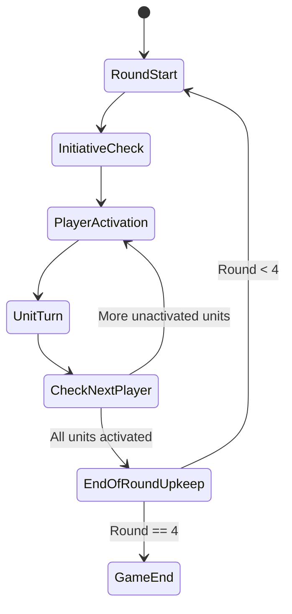
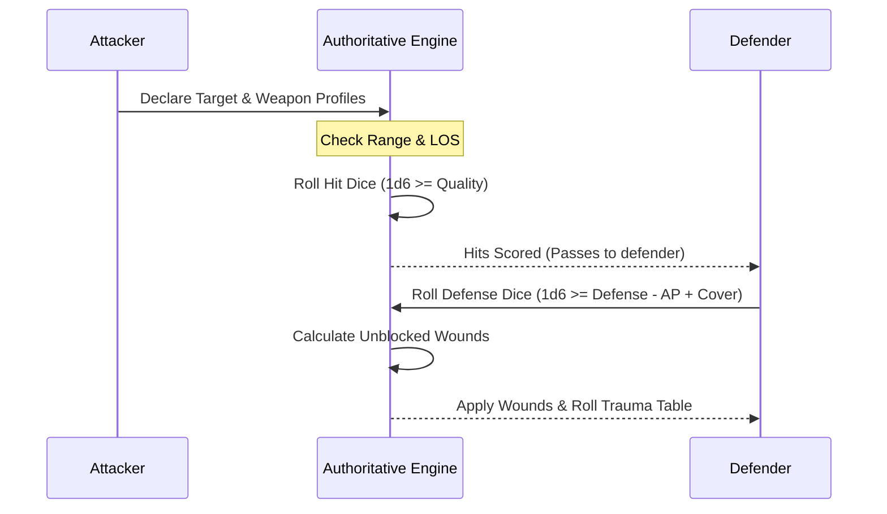

# SkirmishLab Rules Engine Specification

> **Clean-Room Mechanical Specification**
> This document specifies the complete first-principles mathematical model, state machine, and trait resolution engine for SkirmishLab tabletop skirmish simulation. It aligns 1:1 mechanically with standard 3.5 skirmish rules (Grimdark Future: Firefight compatible) using distinct, independent terminology and schemas.

---

## 1. Core Mathematical Axioms

### 1.1 Competence Tests (D6 Metric)
All unit capabilities test against a six-sided die (1d6) relative to an intrinsic Quality threshold ($Q \in [2, 6]$):
$$\text{Success} \iff \text{Roll} \ge Q$$

- **Natural 6 (Critical Success):** An unmodified roll of 6 always succeeds, regardless of negative situational modifiers.
- **Natural 1 (Critical Failure):** An unmodified roll of 1 always fails, regardless of positive situational modifiers.

### 1.2 Armor & Protection Tests (Defense)
Defense tests are rolled by defending units per incoming hit against an Armor/Defense threshold ($D \in [2, 6]$):
$$\text{Blocked} \iff (\text{Roll} + \text{CoverMod} - \text{AP}) \ge D$$
- An unblocked hit causes exactly **1 wound** (unless modified by damage traits like `Deadly(X)`).

---

## 2. Battlefield Geometry & Setup

### 2.1 Spatial Dimensions & Coherency
- **Table Dimensions:** Standard $48" \times 48"$ ($4' \times 4'$) playing area, or compact custom formats with at least **24" separation** between opposing deployment lines.
- **Deployment Zones:** Opposing table edges up to **12" depth**.
- **Model Coherency:**
  - Every model in a squad must remain within **1" horizontal** of at least one other squad member.
  - Every model in a squad must remain within **6" horizontal** of all squad members.
- **Proximity Exclusion Zone:** Models may not enter within **1"** of an opposing model unless executing an Assault/Charge maneuver.

### 2.2 Objective Placement & Control
- **Quantity:** $N = \lfloor\text{d}3\rfloor + 2$ objectives (3 to 5 markers).
- **Placement Rules:** Placed alternately by players outside deployment zones and $> 9"$ apart from each other.
- **Seizure & Contest Rules:**
  - Evaluated at the **end of each round**.
  - A marker is **controlled** by a player if they have at least one friendly model within **3" horizontal** and zero enemy models within 3".
  - Markers remain under a player's control even after leaving the radius.
  - If opposing units are simultaneously within 3", the objective becomes **contested** and reverts to neutral.
  - Suppressed / Shaken units cannot seize or contest objectives.
- **Match Duration:** Exactly **4 rounds**. The player controlling the most objectives at the end of round 4 wins.

---

## 3. Turn & Activation Flow



### 3.1 Initiative Progression
1. **Round 1:** Player who won the pre-game deployment roll-off takes the first activation.
2. **Subsequent Rounds (2–4):** The player who finished activating all of their units first in the preceding round takes the first activation.

### 3.2 Activation Maneuvers
A player selects one ready unit that has not yet activated this round. The unit chooses exactly **one** of the following four maneuvers:

| Maneuver | Movement Distance | Action Capabilities |
| :--- | :--- | :--- |
| **Hold (Stationary)** | $0"$ | May fire ranged weapons. |
| **Advance (Standard Move)** | Up to Base Speed ($6"$) | May fire ranged weapons after completing move. |
| **Rush (Dash)** | Up to $2 \times$ Base Speed ($12"$) | Ineligible to shoot. |
| **Charge (Assault)** | Up to $2 \times$ Base Speed ($12"$) | Must reach base contact with enemy; initiates Melee. |

---

## 4. Ranged Combat Resolution



1. **Targeting & Split Fire:**
   - Attacker must have line of sight and target within weapon range.
   - A squad may divide its fire among up to **two distinct targets**, provided each target is fired upon by distinct weapon profiles.
2. **Hit Allocation:**
   - Attacker rolls 1d6 per weapon attack count. Each roll $\ge Q$ scores 1 hit.
3. **Protection Test:**
   - Defender rolls 1d6 per hit scored. A roll $\ge D$ blocks the hit.
   - **Cover:** Grants $+1$ to Defense rolls if target is in cover terrain or obscured behind sight-blocking terrain.
   - **Armor Piercing (AP):** Subtracts $X$ from defender's roll.
4. **Wound Infliction:**
   - Each failed defense die inflicts 1 wound marker on the target. Proceed immediately to **Section 6 (Casualty & Trauma Table)**.

---

## 5. Close Quarters Combat (Melee)

1. **Charge Contact & Consolidation:**
   - Charging models must move into base contact with enemy models (or as close as geometry allows).
   - Defending models in the target unit consolidate up to **3"** toward the chargers into base contact.
2. **Striking Reach:**
   - All models within **2" horizontal** and **4" vertical** of an enemy model strike with all equipped melee weapons.
3. **Simultaneous Melee Resolution:**
   - Attackers roll hits (Quality test) and defenders roll saves (Defense test) following standard combat rules.
4. **Retaliatory Strike:**
   - If the defending unit survives, it may choose to strike back with its eligible models.
5. **Separation & Consolidation:**
   - If either unit is completely wiped out, the surviving unit may consolidate up to **3"**.
   - If both units survive, the charging unit must push back to create a **1" gap** between the units.
6. **Fatigue / Exhaustion:**
   - Once a unit has charged or retaliated in melee during a round, it becomes **Fatigued**.
   - For the rest of the round, fatigued units only hit in melee on **unmodified natural 6s**.

---

## 6. Casualty, Trauma & Squad Allocation

Whenever a model suffers wounds, place **1 trauma token** per wound next to the model.

### 6.1 Multi-Model Squads
- For units containing multiple models, **each wound immediately eliminates one model** until only the final surviving model remains.
- Only the **final surviving model** in a squad accumulates trauma tokens and rolls on the Trauma Table.

### 6.2 Trauma Roll Table (1d6 + Tokens)
The defender rolls 1d6 and adds the model's total accumulated trauma tokens:

$$\text{Trauma Score} = \text{1d6 Roll} + \text{Total Accumulated Tokens}$$

| Trauma Score | Status Effect | Gameplay Consequences |
| :---: | :--- | :--- |
| **1 – 5** | **Suppressed (Shaken)** | • Model remains in play.<br>• Gains $+1$ to all future Trauma Table rolls.<br>• Must spend its entire next activation idle/recovering to clear suppression.<br>• May strike back in melee, but always counts as **Fatigued** (hits only on 6s).<br>• Automatically fails all morale checks.<br>• Cannot contest or seize objective markers. |
| **6+** | **Knocked Out (Destroyed)** | • Model is eliminated and removed from play. |

---

## 7. Morale & Army Breaking

At the **end of each round**, evaluate total army strength:

1. **Threshold Check:**
   - If an army is reduced to **$\le 50\%$** of its initial starting unit count, the army enters a Broken state.
2. **Morale Test:**
   - Every surviving unit in the broken army must take a Morale Test: roll 1d6 $\ge$ Quality.
3. **Outcomes:**
   - **Pass ($\ge Q$):** Unit maintains composure and continues fighting.
   - **Fail ($< Q$):** Unit becomes **Suppressed (Shaken)**.
   - **Critical Fail (Already Shaken):** If a unit is *already* Suppressed/Shaken when it fails a Morale Test, it immediately **Panics / Routs** and is removed from play as destroyed.

---

## 8. Environmental Obstacles & Terrain

| Terrain Type | Environmental Rule | Mechanical Implementation |
| :--- | :--- | :--- |
| **Cover Terrain** | Light foliage, low barricades, rubble, visual obscuration. | Defenders receive **$+1$ to Defense rolls** against shooting attacks when majority of unit is positioned within or behind cover. |
| **Difficult Terrain** | Mud, dense trenches, steep inclines, deep water. | Maximum movement distance across the entire activation is **capped at 6"** (negates speed bonuses for Rush and Charge). |
| **Dangerous Terrain** | Minefields, acid pools, barbed wire, electrified wire. | When moving through or activating inside dangerous terrain, roll 1d6 per model (or Tough value dice). Every **roll of 1 inflicts 1 wound**. |

---

## 9. Comprehensive Trait & Special Rules Matrix

Every special rule is modeled as a declarative modifier or state machine interceptor:

| Trait | Mechanical Specification |
| :--- | :--- |
| **Ambush** | Unit is held in reserve. At the start of round 2, 3, or 4, deploys anywhere $>9"$ from enemy units. Cannot seize/contest objectives on deployment round. |
| **AP(X)** | Subtracts $X$ from defender's Defense saving throws against this weapon. |
| **Bane** | Ignores target's `Regeneration`. Target must re-roll unmodified saving throw results of 6. |
| **Blast(X)** | Ignores cover. Multiplies hits by $X$ (up to maximum number of enemy models within $3"$ of target). Defender splits hits evenly among units within $3"$. |
| **Caster(X)** | Generates $X$ tokens per round (cap 6). Spends tokens equal to spell cost to cast; succeeds on 1d6 roll of 4+. Friendly/enemy casters within 18" in LOS may spend tokens to grant $\pm 1$ modifier. |
| **Counter** | Strikes first in melee when charged. Attacking charger suffers $-1$ Impact hit per model with Counter. |
| **Deadly(X)** | Wounds from this weapon deal $X$ wounds each. Resolved first; extra wounds do not carry over to other models in squad. |
| **Fast** | Increases movement: $+2"$ to Advance (Speed 8"), $+4"$ to Rush/Charge (Speed 16"). |
| **Fear(X)** | Model counts as having dealt $+X$ additional wounds when calculating Trauma Table roll in melee (requires at least 1 actual wound dealt). |
| **Fearless** | When failing a morale test, roll 1d6. On a 4+, the test is treated as passed. |
| **Flying** | Ignores terrain effects and intervening models while moving. Automatically succeeds on jump checks. |
| **Furious** | When charging, unmodified hit rolls of 6 in melee generate 1 additional hit (bonus hit does not trigger further 6s). |
| **Hero** | Friendly units within 12" may test Morale using the Hero's Quality score (provided Hero is not Suppressed). |
| **Immobile** | Unit may only execute **Hold** actions. Cannot move, advance, or charge. |
| **Impact(X)** | On charging, rolls $X$ dice before normal attacks (unless fatigued). Each roll of 2+ inflicts 1 immediate hit. |
| **Indirect** | Fires without requiring line of sight and ignores cover from sight blockers. Suffers $-1$ to hit if firing after moving. |
| **Limited** | Weapon profile or ability may only be used **once per match**. |
| **Regeneration** | Whenever suffering wounds, roll 1d6 per wound. On a **5+**, the wound is ignored. |
| **Relentless** | When shooting at targets $>9"$ away, unmodified hit rolls of 6 generate 1 additional hit. |
| **Reliable** | Attacks made with this weapon always hit on a Quality test of **2+**, regardless of unit's base Quality. |
| **Rending** | Ignores `Regeneration`. Unmodified hit rolls of 6 gain **AP(4)**. |
| **Scout** | Infiltrates during deployment. Deployed after all standard units, placed anywhere fully within 12" of friendly deployment zone. |
| **Slow** | Decreases movement: $-2"$ to Advance (Speed 4"), $-4"$ to Rush/Charge (Speed 8"). |
| **Stealth** | When targeted by ranged attacks from $>9"$ distance, enemy attack rolls suffer a **$-1$ penalty to hit**. |
| **Strider** | Ignores Difficult Terrain speed cap. Automatically passes jump checks on 2+. |
| **Surge** | Unmodified hit rolls of 6 deal 1 additional hit. |
| **Thrust** | When charging, attacks gain **$+1$ to hit** and **AP(+1)** in melee. |
| **Tough(X)** | Accumulates wounds without rolling trauma until reaching $X$ wounds. Only knocked out on trauma rolls $\ge 5 + X$. |
| **Unstoppable** | Ignores target's `Regeneration`, and ignores all negative modifiers applied to this weapon. |

---

## 10. Advanced Dynamic Traversal Rules

### 10.1 Knockback / Pushing
Whenever a target model receives a **Suppressed (Shaken)** result from an attack, the attacking player may roll 1d6. On a **4+**, the attacker displaces the target model by up to **2"** in any horizontal direction.

### 10.2 Gaps & Drops (Jumping)
- **Standard Clearance:** Models cross horizontal gaps $\le 1"$ and drop elevations $\le 3"$ without penalty or testing.
- **Extended Clearance ($\le 6"$):**
  - Requires a Jump test: Roll $X + 1$ dice testing for $3+$, where $X$ is 1 die per full 3" traversed.
  - If all dice succeed ($3+$), the model clears the distance without expending its normal movement allowance.
  - If any die fails, the model falls.

### 10.3 Falling Damage
- If a model falls or is pushed off an elevated surface $\ge 2"$ tall:
  - Takes 1 automatic hit with **AP(1) per full 3" of vertical fall**.
  - Model lands within 2" of the bottom edge and its activation terminates immediately.
  - In multi-model squads, a fall eliminates the individual model unless only the squad survivor remains.

---

## 11. Data Pack Architecture & Serialization Schema

```typescript
export interface UnitProfile {
  id: string;
  name: string;
  cost: number;
  quality: number;      // e.g. 4 for 4+
  defense: number;      // e.g. 5 for 5+
  speed: number;        // Standard base speed, default 6
  size: number;         // Model count in squad
  wounds: number;       // Current trauma count
  status: Array<'ready' | 'activated' | 'suppressed' | 'fatigued' | 'engaged' | 'destroyed'>;
  weapons: WeaponProfile[];
  traits: TraitInstance[];
}

export interface WeaponProfile {
  id: string;
  name: string;
  range: number;        // 0 for melee, >0 for ranged (inches)
  attacks: number;      // Attack dice count
  traits: TraitInstance[];
}

export interface TraitInstance {
  type: TraitType;
  value?: number;       // e.g. X for AP(X), Tough(X), Blast(X)
}
```
