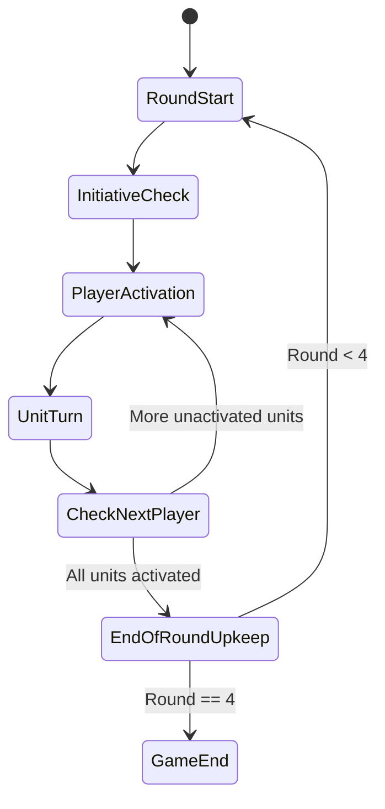

# SkirmishLab Rules Engine Specification

> **Mechanical Specification**
> This document specifies the complete mathematical model, state machine, and trait resolution engine for SkirmishLab tabletop skirmish simulation. It targets the Grimdark Future: Firefight rules and uses their terminology; sections not yet updated for v3.6 still describe the engine as built (14C-2 brings the mechanics in line).

---

## 1. Core Mathematical Axioms

### 1.1 Competence Tests (D6 Metric)
All unit capabilities test against a six-sided die (1d6) relative to an intrinsic Quality threshold ($Q \in [2, 6]$):
$$\text{Success} \iff \text{Roll} \ge Q$$

- **Natural 6 (Critical Success):** An unmodified roll of 6 always succeeds, regardless of negative situational modifiers.
- **Natural 1 (Critical Failure):** An unmodified roll of 1 always fails, regardless of positive situational modifiers.

### 1.2 Armor & Protection Tests (Defense)
Defense tests are rolled by defending units per incoming hit against an Armor/Defense threshold ($D \in [2, 6]$):
$$\text{Blocked} \iff (\text{Roll} + \text{CoverMod} - \text{AP}) \ge D$$
- An unblocked hit causes exactly **1 wound** (unless modified by damage traits like `Deadly(X)`).

---

## 2. Battlefield Geometry & Setup

### 2.1 Spatial Dimensions & Coherency
- **Table Dimensions:** Standard $48" \times 48"$ ($4' \times 4'$) playing area, or compact custom formats with at least **24" separation** between opposing deployment lines.
- **Deployment Zones:** Opposing table edges up to **12" depth**, shallower on small tables so the two zones are always at least **24"** apart (e.g. 3" deep on a 30"-deep table). The game board is the map's own size (the default battlefield is 48" × 48"; boards run from 24" to 72" per side, and maps saved at 44" × 30" keep that size).
- **Measuring rule (base edges):** every distance between two models is measured between the closest points of their bases (centre distance minus both base radii; bases are 1" wide, radius 0.5"), and distances to a marker run from the marker point to the model's base edge. This covers weapon range, range-gated rules (`> 9"`), coherency, the 1" exclusion/deployment gap, objective control and engagement. Movement allowances are path lengths and stay centre-based, because a model moves its centre. Heights are separate limits. In code: `shared/src/engine/unitGeometry.ts` (`modelGap`, `markerGap`, `unitDistance`, `unitsInContact`). Between units everything is measured model to model (the closest pair of living models); `unit.position` is only a display anchor.
- **Model Coherency:**
  - **One unbroken chain (batch 1I PR 28):** two models are *linked* by the distances below; the links must join every living model into a single connected group. Two separate pairs a few inches apart are not coherent, even inside the 6" spread. The host and the HUD both refuse a move, rush, charge or deployment that ends split ("Squad is split into N groups ..."). Casualties can break a chain; regrouping is a separate rule.
  - Every model in a squad must remain within **1" horizontal** (base edge to base edge) of at least one other squad member. When the two models are on different levels (heights differ by more than 0.5"), the allowance is **3"** instead. Simplification: this applies whenever the models are on different levels; the game does not check whether they would all fit on one level.
  - Every model in a squad must remain within **6" horizontal** (base edge to base edge, 7.0" centre to centre) of all squad members.
  - **Coherency at the start of an activation:** a squad that begins its activation out of coherency must spend it getting back together. It may not Hold, or end its activation without having moved. Shooting without having moved counts as holding, so it is refused too; an Advance first and then shooting is allowed. The host rejects `hold` / `end-activation` / `shoot` for such a squad before it has moved or attacked; the HUD disables Hold and Shoot and shows a hint. Shaken units are exempt (they cannot move; their idle activation only clears Shaken) and a lone surviving model is always coherent.
  - **Regrouping, closer counts (batch 1I PR 29):** a squad that started a move, rush, charge or charge leg out of coherency may end it still out of coherency if it ends measurably closer to coherent ("or as close as possible"). Closeness is the *coherency shortfall*: the total length missing from the chain (the gap between separate groups included, each link measured against its level-aware limit) plus how far the widest pair exceeds the 6" spread. The end must lower the shortfall by more than 0.05" compared with the positions before that action or leg; a squad that started coherent must still end coherent. A split move or charge compares each leg with the positions before that leg.
  - **Partial squad moves:** each model moves *up to* the allowance, so a model may stay put. A move/rush may be confirmed before every model has been placed; unplaced models keep their position (a one-point path, 0" of movement) and the final positions must still be coherent, off other models and not mid-air. A rush with unmoved models is still a rush.
- **Proximity Exclusion Zone (the 1" rule):** a model may not come within **1"** (base edge to base edge) of any living model of **another unit, friendly or enemy**, unless it is charging, and then only toward the declared charge target. It applies to the whole move or rush path, not just the end: the host rejects a path that brushes closer, and the pathfinder stops short or routes around. A model that already starts closer than 1" (for example next to a friendly squad) may move away but not get any closer than it began. Exactly 1.0" is allowed. Deployment uses the same gap (an enemy must be more than 1" away, measured to the closest enemy model). A move or rush that would end with its base edge within **0.5"** of an enemy is reported as melee contact (use a charge). Models also never move **through** other models: every living model of every other unit is an obstacle along the whole path (a charge may touch its target's models, never pass through one).

### 2.2 Objective Placement & Control
- **Setup order:** `setup` -> `objectives` -> `deployment` -> `activation`. In the objectives phase the server rolls one d6 for the objective count, then the **mission roll-off** decides who places first. At the end of the last placement the **deployment roll-off** decides who deploys first and activates first in round 1. A **roll-off** is ten pairs of d6 (host die, guest die): the first unequal pair decides and the higher die wins; if all ten pairs tie the host wins. Sides stay fixed (host south, guest north).
- **Quantity:** one d6, halved and rounded up, plus 2: $N = \lceil\text{d6}/2\rceil + 2$ objectives (3 to 5 markers).
- **Placement Rules:** placed alternately by the players, starting with the mission roll-off winner (`place-objective`). A marker must be on the board, **outside both deployment zones** (a spot on the zone edge counts as inside), **more than 9" horizontally** from every marker already placed, and where a model could stand: on the ground or on top of a walkable surface (its height is that surface's), clear of terrain solids, stairs and ladders. The host validates every placement. Maps do not define objectives (any in an old map are ignored). A match without the deployment phase runs the same objectives phase before round 1: units keep their automatic positions, and after the last marker the deployment roll-off decides who activates first and play goes straight to round 1. A unit that is not on the table (an Ambush unit in reserve, or a Scout still held back) cannot be activated, held, moved or targeted.
- **Seizure & Contest Rules:**
  - Evaluated at the **end of each round**.
  - A marker is **controlled** by a player if they have at least one friendly model within **3" horizontal** of the marker, measured to the model's base edge (centre up to 3.5"), and zero enemy models within the same distance.
  - **Squads count per model:** each living model of a multi-model unit is checked on its own base edge (and the 3" vertical limit); the unit's anchor point (centroid) never counts, so a squad whose models all stand outside the ring does not hold a marker even if its middle is inside it. Single models are unchanged.
  - Markers remain under a player's control even after leaving the radius.
  - If opposing units are simultaneously within 3", the objective becomes **contested** and reverts to neutral.
  - Suppressed / Shaken units cannot seize or contest objectives.
- **Match Duration:** Exactly **4 rounds**. The player controlling the most objectives at the end of round 4 wins.

### 2.3 Vertical Traversal: Stairs, Ladders & Ramps
- **Stair Ramps (Triangular Prism Geometry):**
  - Stairs and access ramps are modeled as solid right-angled triangular prisms (wedges).
  - The side faces and rear risers are impassable solid obstacles.
  - The sloped hypotenuse surface provides a smooth continuous walkable plane: elevation $y(t) = y_{\text{foot}} + t \cdot (y_{\text{head}} - y_{\text{foot}})$ scales linearly as the model traverses the horizontal length.
  - Traversal proceeds at normal 1:1 speed (no Difficult Terrain penalty). Units may halt mid-slope if movement allowance is exhausted.
- **Vertical Ladders:**
  - Ladders provide 1:1 vertical climb speed.
  - In physical tabletop play, miniatures cannot balance suspended on vertical rungs. A climbing model must have sufficient movement allowance to reach the landing platform deck; if insufficient movement remains, the model halts at the ladder foot.
  - The ladder hangs on the deck face. The foot is a base's width off the face on the ground and the head is the same distance in over the deck, so a model's base never overlaps the ladder or deck. The climb itself is vertical; the short step between the climb line and the foot/head spot is not measured.
- **Climbing (without a ladder or stairs):** a model may climb onto the floor of a *climbable* piece when the rise is 3" or less. Climbability is a property of the terrain, not of the geometry: each type has a default (shipping container and ruins yes; platforms, decks and catwalks no, which keeps ladders and stairs meaningful) and a single piece can override it. The model first stands a full base off the face (the same stand-off spot as a drop), the climb is straight up, and then it steps in over the edge. The climb height counts as movement (the stand-off step and the step in count too), it is **not** difficult terrain, and it cannot end part-way up: with too little movement left the model stays at the stand-off spot. The spot must be clear of terrain all the way up, so a ledge behind a tall wall cannot be climbed from outside. Rises over 3" need a ladder or stairs.
- **Multi-Model Squad Traversal:**
  - Constituent models in a squad navigate along independent physical pathfinding trajectories avoiding terrain.
  - Terrain collision is evaluated per model path rather than an abstract squad centroid ray, allowing squad members to legally flank obstacles and cover without false collision blocks.
  - Sequential placement enforces $\le 2.0″$ coherency relative to already staged models.

---

## 3. Turn & Activation Flow



### 3.1 Initiative Progression
1. **Round 1:** Player who won the deployment roll-off (rolled with the last objective placement) takes the first activation; deployment alternates one unit at a time starting with them.
2. **Subsequent Rounds (2–4):** The player who finished activating all of their units first in the preceding round takes the first activation.

### 3.1.1 Match End
The match ends in one of three ways:
- **Objectives (end of round 4):** the player holding more objectives wins. **A tie is a draw**: there is no tie-break (no destruction points or other tournament scoring) for now.
- **Elimination:** a player with no living units loses (mutual elimination has no winner).
- **Rematch:** once the match is over, either player may ask to play again; when both have asked, the same room restarts the exact same game (same board, terrain, placed objectives with control reset, both roll-off results (the objectives phase is skipped), armies, unit ids and starting positions, deployment mode, sides and starting player) with an empty log. Only the game id differs. The ask needs no dice and is the only action accepted after game over; there is no withdraw.
- **Concede:** either player may concede at any moment until the match is over (deployment, either player's turn, during a pending reaction or a declared charge). The conceding player loses and the opponent wins; the reason reads "<name> conceded". Concede needs no dice.

The results screen is built from `summarizeMatch(state)`: winner, reason, rounds played, objectives held and per-side losses. A unit counts as lost when it is destroyed or routed; models count as lost only when destroyed.

### 3.2 Activation Maneuvers
A player selects one ready unit that has not yet activated this round. The unit chooses exactly **one** of the following four maneuvers:

| Maneuver | Movement Distance | Action Capabilities |
| :--- | :--- | :--- |
| **Hold (Stationary)** | $0"$ | May fire ranged weapons. |
| **Advance (Standard Move)** | Up to Base Speed ($6"$) | May fire ranged weapons after completing move. |
| **Rush (Dash)** | Up to $2 \times$ Base Speed ($12"$) | Ineligible to shoot. |
| **Charge (Assault)** | Up to $2 \times$ Base Speed ($12"$) | Must reach base contact with enemy; initiates Melee. |

### 3.3 Movement Budget & Incremental Micro-Moves
- **Movement Allowance Budgeting:** At activation start, a unit possesses a movement allowance (`remainingMovement`) equal to its speed ($6.0″$ for Advance, or $12.0″$ for Rush).
- **Incremental Micro-Moves:** Players may spend from this budget across multiple sequential move actions (e.g. advance $2.5″$ to peek around a corner, verify Line of Sight, and advance another $3.5″$).
- **Shooting Window Closure:** Firing a ranged weapon immediately exhausts all remaining movement allowance (`remainingMovement = 0`), ending the movement phase for that activation.
- **Split Charges (legs):** a Charge is one continuous move with a single budget (double speed, e.g. 12"). When no single safe path reaches the target, the player *declares* the charge on a target and then spends the budget in legs: each leg is a safe walk, or a jump/fall declared from a floor edge exactly like a move. A passed jump costs no movement; a failed jump falls and ends the activation with no melee. The legs plus the final move into contact may never exceed the one budget (Difficult Terrain still caps the whole charge at 6"). In a squad, every model has its own distance: what a model walked in earlier legs counts against that model only, and the Difficult Terrain cap applies to each model separately. A separate move action before a charge is not allowed (one action per activation). During legs, every other unit keeps the 1" edge-to-edge keep-away rule; only the declared target may be approached into base contact. A declared charge can't be undone or turned into another action: the only ways out are the final contact (melee resolves normally) or ending the activation, which abandons the charge with no melee.
- **Rush Commitment:** Choosing Rush grants double movement allowance ($12.0″$) and immediately locks out shooting (`hasAttacked = true`), permitting incremental micro-moves until the full budget is spent or the player concludes the activation.

---

## 4. Ranged Combat Resolution


1. **Targeting & Split Fire:**
   - Shooting is per model. A target unit is valid for a weapon when at least one attacking model has line of sight (traced from that model's eye) to **some** living model of the target **and** that same target model is within the weapon's range, measured base edge to base edge. An Indirect weapon needs range only while its unit has held (not moved this activation); after moving it needs line of sight like any weapon.
   - **Who fires:** only the attacking models that meet that test fire; the weapon's attack count is its attacks times the number of firing models (the other models neither see nor reach the target). Split-fire allocations apply the same test per weapon group.
   - **Blocking:** an attacker's own squad-mates never block its sight; models of any other unit (friend or foe) do. The target unit's own models do not block sight to each other.
   - **Distance rules:** the `> 9"` rule checks and the distance shown to the player use the closest pair of models. `unit.position` is only an anchor for a squad and is never used to measure between units.
   - A squad may divide its fire among up to **two distinct targets**, provided each target is fired upon by distinct weapon profiles.
   - **Simultaneous Salvo:** One `shoot` action is a single simultaneous salvo: every declared weapon allocation captures its target model count, cover status, and `Blast(X)` participants/caps from the pre-salvo battlefield state before any allocation applies casualties. Wounds are then applied in allocation order (with `Deadly` allocations applying wounds first).
2. **Hit Allocation:**
   - Attacker rolls 1d6 per weapon attack count. Each roll $\ge Q$ scores 1 hit.
3. **Protection Test:**
   - Defender rolls 1d6 per hit scored. A roll $\ge D$ blocks the hit.
   - **Cover:** Grants $+1$ to Defense rolls if target is in cover terrain or partially obscured behind terrain:
     - *Low cover (crates, barricades):* Attack ray must pass through intervening cover between shooter and target. Terrain adjacent to the shooter (within 1.0") is ignored — shooting out of cover does not grant cover to open targets downrange. Defending targets must have their base edge within **1.0"** of the low cover piece the shot crosses, measured base edge to piece like every other rules distance (or be inside area terrain) to receive the $+1$ Defense bonus, matching tabletop True-Line-of-Sight where low waist-high crates do not obscure open fighters downrange.
     - *Sight-blocking cover (solid walls, columns):* Target must be within 1.0" of the piece and partially obscured from the shooter's vantage point (at least one ray to the model's flanks is blocked while center LoS remains open). Terrain situated behind or beside the target without obscuring it grants no cover.
     - *Apertures (Windows & Doorways):*
       - *Doorways (`wall-doorway`):* Open air between two jambs under a lintel. Line of Sight and movement pass freely and the doorway itself gives no cover; a model partly hidden behind a jamb claims ordinary sight-blocker cover.
       - *Windows / Firing Ports (`wall-window`):* Windows block model movement. Line of Sight can only be drawn through a window if at least one fighter (shooter or target) has its base edge within **1.0"** of the window aperture ("manning the port" / peeking). A model within 1.0" of a window receiving fire through it gains $+1$ Defense (Cover). If both models are $>1.0"$ from the window, the wall blocks sight entirely (preventing distant geometric keyholing).
   - **Squad targets:** each living target model is judged individually against the nearest firing model. The unit has cover only if a strict majority of its living models are in cover (3 of 4 yes; 2 of 4 or 1 of 4 no). A single-model target is judged on its own, as before.
   - **Armor Piercing (AP):** Subtracts $X$ from defender's roll.
4. **Wound Infliction:**
   - Each failed defense die inflicts 1 wound marker on the target. Proceed immediately to **Section 6 (Wounds, Tough & Casualties)**.

---

## 5. Close Quarters Combat (Melee)

1. **Charge Contact & Consolidation:**
   - Charging models must move into base contact with enemy models (or as close as geometry allows). A charge counts as reaching its target when a charging model's base edge ends within 0.25" of the base edge of the **closest model** of the target unit (and within 4" vertically); melee is possible while some pair of models has base edges within 0.5" (the old 1.25" / 1.5" centre values, unchanged for single models). A squad charges **model by model** (batch 1D PR 11): the charge is valid when at least one charging model can reach base contact with a target model (no line of sight needed); each charging model then walks its own path, up to the charge distance (one budget, each model's own path must fit it; the Difficult Terrain 6" cap applies per model), ending in base contact with a model of the target unit or as close as it can get. The squad must end in coherency (split-level rule included), no model passes through another unit's model, and the 1" keep-away is waived only toward the declared target. **As close as possible (batch 1I PR 32):** the host accepts a final charge when at least one model ends in contact (within 0.25" base edge, 4" vertically) and every other model ends with a base-edge gap to the target no more than 0.5" larger than the best it could have managed. The best spot is found by `closestApproach` (`shared/src/engine/closestApproach.ts`) from where the model started, using its own remaining distance, the other models' submitted end spots, and ordinary movement only (walking, stairs, ladders, drops up to 3", gaps up to 1", climbs up to 3"; never a jump, and never a route that needs a Hazard test), keeping a legal end and squad coherency (a squad that started out of coherency only has to avoid getting worse). A model is never required to jump. If a model has no legal spot at all the rule does not apply to it. Charge legs have no closeness rule. Models may jump individually (declared per model, as for squad moves). Models the player does not place in a final charge (Confirm charge early, once a placed model touches the target) are moved as close as they can by the same helper, in model order; when no placed model touches the target the confirmation is a leg and unplaced models stay where they are. A squad charge (more than one living model) must send per-model positions: the host rejects the old single-path block charge. Units with a single model (or a squad down to one living model) keep the plain one-path charge.
   - **Pile-in by the defender (batch 1I PR 33):** after the charge, if the target has living models that are not in base contact with a charging model, the defending player places those models themselves before the charger strikes. Each listed model moves up to **3"** by ordinary movement only (walking, stairs, ladders, drops up to 3"; no jumps, no hazards), ending in base contact with a charging model or about as close as it can get: the host accepts an end whose base-edge gap to the chargers is at most 0.5" larger than the best `closestApproach` finds for that model (budget 3", the other models' submitted spots). Models already in contact do not move. The end spots must be legal (on the board, supported, no overlap, 1" keep-away waived toward the chargers only) and the unit must end coherent (one chain); a unit that started out of coherency may not end less coherent. The charger's strike is rolled only after the placement is confirmed, and the strikers are counted from the confirmed spots; then the usual strike-back prompt, fatigue and step back follow. The defender has **60 s**; when it runs out the host places the models itself with the same helper (nearest the chargers first). A target with a single living model, or one whose models all touch a charger, skips the prompt and the strike is rolled with the charge as before.
   - The 1" rule is waived toward the charge target only; other units still keep a 1" edge gap.
   - A charge that no single safe path can reach is declared first and made in legs (section 3.3); the final leg into contact then resolves exactly like a one-click charge. Abandoning a declared charge (ending the activation) means no melee. Squads use the same flow with per-model legs: each leg moves the models, every model adds its own path to its own running total, and the final charge needs at least one model in contact. A model that walked further than its squad-mates in an earlier leg has less left; the others keep their full remaining distance.
2. **Striking Reach:**
   - Only the models within **3" horizontal** (base edge) and **4" vertical** of some model of the enemy unit strike; their attacks are pooled (the weapon's attacks times the number of striking models that carry it; a lone fighter with nobody in reach yet still counts one). This holds for the charge strike, a fight and the defenders' strike-back, and it is counted after the charger has moved in and the defenders have piled in (`strikingModelCount`; `getDiceSpecs` simulates the move so the dice count matches). Before this rule every living model of the striking unit rolled.
   - **Every weapon strikes (14C-3 PR 1B):** each model in reach strikes with every melee weapon it carries, Assault weapons included, one resolution per weapon in equipment order (a Leader with a Hand Weapon A6 and a Pistol A2 Assault strikes 6 + 2). Per weapon, only the models that carry it and are within reach count. A charged unit's Counter weapons strike first; its strike-back then uses all its non-Counter melee weapons (all of them when it made no Counter strike). Impact stays per striking model. The wounds of every weapon count towards the melee result.
   - **Per-model loadouts:** a fighter may give each model its own weapons (`modelLoadouts`). A weapon fires or strikes once per living model that carries it; a model removed as a casualty takes its weapons with it. Weapons of the same name still share one target when shooting.
3. **Simultaneous Melee Resolution:**
   - Attackers roll hits (Quality test) and defenders roll saves (Defense test) following standard combat rules.
4. **Retaliatory Strike:**
   - If the defending unit survives, it may choose to strike back with its eligible models.
5. **Separation & Consolidation:**
   - If either unit is completely wiped out, the surviving unit may consolidate up to **3"**.
   - If both units survive, the charging unit must push back to create a **1" gap** between the units. It is done per model (batch 1D PR 11): every charging model that is within 1" (base edge) of any enemy model slides directly away to a 1" gap; models already clear stay put. The new spots must be on the board, clear of terrain and models and keep a coherent squad coherent; otherwise the whole formation steps back together along the old anchor line.
6. **Fatigue / Exhaustion:**
   - Once a unit has charged or retaliated in melee (or finished a Counter exchange) during a round, it becomes **Fatigued** (`fatigued` status). If a Counter unit finishes its Counter strikes when the charger was destroyed or has no melee weapons left, or declines a non-Counter strike-back after countering, it still becomes Fatigued once the melee exchange completes.
   - For the rest of the round, fatigued units only hit in melee on **unmodified natural 6s**.

---

## 6. Wounds, Tough & Casualties

Every unblocked hit is one wound (before Deadly, Regeneration or other rules change the count). There is no wound-effect table and no trauma roll.

### 6.1 Tough(X)
- A model is killed (removed from play) when its wounds reach its **Tough** value. A model without `tough(X)` has Tough 1, so one wound kills it. Models store their remaining wounds (`Model.wounds`, starting at `Model.maxWounds`); a unit's `wounds` is the total left across its living models.
- **Deadly first:** when one attack uses several weapons on the same unit (a shoot with several allocations, or a unit's multi-weapon melee strike including a strike-back and the Counter strikes), the wounds of Deadly weapons are applied before the others, so a Deadly hit kills an unhurt model and the plain wounds then land on another. Otherwise the order stays as declared (equipment order); wounds left over after the target is wiped out are lost.
- A wounded model keeps taking wounds until it dies before another model takes any. When a new model has to start taking an attack's wounds, the living model with the most wounds already taken goes first (ties by place in the unit); only when no model is wounded does the squad's owner choose the next one (see 6.2). Deadly(X) wounds from one hit arrive as a chunk of X: what is left of the chunk after the model it kills does not carry over to another model.
- While a single Tough model is hurt, the HUD shows the wounds it has taken (for example `2/3 W`).

### 6.2 Multi-Model Squads
- **The owner assigns wounds in the tabletop order (batch 1I Decision 37, reworked by 14C-3 Decision 3g).** An attack's wounds go to one model at a time: an already-wounded model always takes wounds first (the most wounded one first), and only when a fresh, unhurt model has to start does the squad's owner choose it. The owner is asked for those unhurt models, as an ordered list: the first picked takes wounds until it is removed, then the second, and so on; the last one may survive wounded. The prompt appears whenever at least two unhurt models could be chosen, so also for wounds that remove nobody (the picked model just ends wounded). No prompt when every wound fits on already-wounded models, or when only one unhurt model could take the spill. Picked models must be unhurt (30 s;  on timeout the host picks, preferring models whose removal keeps the squad one connected chain, then list order). Any living models may be picked: sight and coherency do not limit the choice, since hits and wounds go to the unit; a pick that breaks the chain is allowed and the squad regroups next activation. Each damaged squad gets its own prompt, in resolution order (split fire at two units: one prompt per unit). If the wounds destroy the whole squad, or the unit has a single model, nothing is asked. In melee the order is: charge strike, the defender's pick, the strike-back (counted from the surviving models within reach), the charger's owner's pick, then the step back or consolidation. Hazard (fall / jump) casualties keep their own picker.
- Wounds replayed after a pick follow that order: the wounded (locked) models first, then the picks in the order given. Fall and dangerous-terrain move hazards keep their own rule: the wounds stay on the model that fell, or on the models the player named for the move.
- Timeout: the host picks only unhurt models, counting the locked models that die as already gone, with the same coherency preference.
- When the last model dies the unit is destroyed.

---

## 7. Morale & Shaken

Morale is tested per unit at the end of an activation, not at the end of the round. There is no army-breaking test.

1. **Trigger (14C-2 PR 1).** At the end of every activation, each unit of either side (including the active unit) that took at least one wound **during that activation** and was **not in melee during it** tests Morale if it is now at **half strength or less**: for several models, living models x 2 <= the unit's starting models; for a single model, remaining wounds x 2 <= Tough. A unit tests at most once per activation. Units in melee skip this test (melee results decide who tests; see the melee rules). The host keeps this in `turnState.woundBaseline` (each living unit's wounds when the activation began) and `turnState.meleeUnitIds`, both cleared when the activation ends.
2. **The test** is a Quality test: roll 1d6, passes on a result of at least Quality; a 1 always fails, a 6 always passes. The only Morale modifier is Hold the Line (+1 when the unit was shot from over 9" or charged from over 6" away). A failure makes the unit **Shaken**. A unit that is already Shaken always fails, with no roll.
3. **Hero.** A unit within **6"** (horizontal, base edge to base edge) of a friendly, living, non-Shaken unit with `hero` may use the better of its own Quality and the Hero's for the test. The Hero may be the unit itself or any friendly unit.
4. **Fearless.** When a unit with Fearless fails a Morale Test (including the automatic failure while Shaken), the host also rolls one die; on a 4+ the test counts as passed (the unit is not made Shaken, and an already-Shaken unit simply stays as it is).
5. **Dice.** All morale dice are server dice requested with the `end-activation` action (`purpose: 'morale'` for each unit that is not already Shaken, `purpose: 'fearless'` for each Fearless unit). A move that can end in a fall or a hold in dangerous terrain also requests a spare `morale` die (and a `fearless` die for a Fearless mover) because the wounded mover's activation ends inside that action. Each test is attached to the action's log entry (`dice.outcome.moraleTests`: unit, roll, Quality needed, Fearless die, passed, outcome) so both peers render it from state.
6. **Shaken units.** A Shaken unit may be activated, but may do nothing except end its activation idle (the host rejects every other action; the HUD offers only *End Activation (idle)*). At the end of that activation Shaken is removed. It may strike back in melee, as **Fatigued** (hits only on unmodified 6s). It can neither seize nor contest objectives. It always fails Morale Tests.
7. **Melee results (14C-2 PR 2).** A unit in melee skips the wound test above. At the end of the activation the host compares, for each pair of units that fought during it, the wounds each took **during that activation** (charge strike, fight, strike-back; wounds stopped by Regeneration or defense do not count). Fear(X): a unit with Fear counts its enemy as having taken X extra wounds **for each of its living models within 3" of a model of that enemy** when the results are compared (plan Decisions 9 and 46; at least one model if the unit fought at all), once per unit however many melees it fought. The side with the higher total loses and takes a Morale Test (a unit already Shaken fails without a die); a tie means nobody tests. A loser that fails **while at half strength or less** (same test as rule 1, judged before the test) **Routs**: all its models are removed and it gets the `routed` status. Otherwise it is Shaken. A loser wiped out by the fighting owes nothing. Fearless can still turn a failure into a pass. The result is logged on the end-activation entry (`dice.outcome.meleeResults`) so the HUD can show "X took 3 wounds, Y took 1 (+1 Fear): X loses".

---

## 8. Environmental Obstacles & Terrain

| Terrain Type | Environmental Rule | Mechanical Implementation |
| :--- | :--- | :--- |
| **Cover Terrain** | Light foliage, low barricades, crates, visual obscuration, window sills. | Low pieces (solids no more than 1.0" above the floor they stand on: barricade, crate, pipe) can be stepped over: movement goes straight across at no extra cost (not a climb, not difficult), but a model may not end its move on or overlapping one. Taller pieces still block movement. Defenders receive **$+1$ to Defense rolls** against shooting attacks when positioned within cover, within 1.0" of intervening low cover along the line of fire, or within 1.0" of a window aperture being fired through. |
| **Aperture Walls** | Doorway passages and window firing ports. | Doorways are open air: movement and Line of Sight pass freely, with no cover from the gap itself. Windows allow Line of Sight through the port only while a model is manning it (base edge within 1.0"), grant that model +1 Defense, and block movement. |
| **Elevated Floors** | Platforms, catwalks and the ruin ledge at the 3.0" floor tier. | Decks are solid slabs: models walk beneath them and stand on top. Sight is traced in 3D, so a deck blocks sight from below at close range while low cover stacked on it (barricades, crates) is seen over and a wall hides a model. Ladders and stairs are the way up onto decks; a piece marked climbable (container, ruin ledge by default) can also be climbed straight up, 3" or less (see 2.3). |
| **Difficult Terrain** | Mud, dense trenches, steep inclines, deep water, rubble. | Maximum movement distance across the entire activation is **capped at 6"** (negates speed bonuses for Rush and Charge). A path is difficult when any **segment** of it passes through a difficult piece's footprint (plus the 0.15" margin) at that piece's level, so a straight walk across a rubble field counts even though both ends are outside it; a model on a deck above the piece, or beside it, is not slowed. Which pieces are difficult is data: the piece's own `isDifficult`, else the catalog default, else a legacy type list (`trench`, `forest`, `mud`) for old saved maps (`isDifficultPiece`). Strider and Flying units are exempt. |
| **Dangerous Terrain** | Minefields, acid pools, barbed wire, electrified wire, hazard pools. | Detected exactly like difficult terrain (segment by segment, at the piece's level; `isDangerousPiece`, legacy types `toxic`, `hazard`, `fire`). A unit whose models move across dangerous terrain, or which activates with any model standing in it (centre inside the footprint at the piece's level), makes **one test per piece**: it rolls as many dice as the wounds it would take to destroy it (sum over living models of Tough minus wounds taken; Tough 1 without `tough(X)`), and every **roll of 1 inflicts 1 wound**, allocated like other wounds (a squad loses models; the mover's casualty priority is used when given). The test when the unit activates in a piece also covers moving out of that same piece; the unit tests again only if its move crosses a **different** dangerous piece. A piece tests at most once per activation, so crossing it again on a later leg, Rush path or charge rolls nothing. Flying units are immune. The dice are tagged `hazard_<terrain piece id>`, one group per piece. |
| **Area Terrain** | Rubble fields and hazard pools: a flat footprint with no walls. | Never blocks movement or sight and is not a floor: a model in or crossing it stays on the ground, and ending a move inside it is legal. Cover is for models **inside**, not behind: where the piece gives cover (rubble field yes, hazard pool no), a unit of several living models counts a model only when its whole base is inside the footprint, a single-model unit (or a squad down to one living model) when its centre is inside. This holds against every line of fire, plunging fire included, and area pieces never give the 1.0" intervening low-cover bonus. A squad still gets cover when more than half its living models are individually covered. |

---

## 9. Comprehensive Trait & Special Rules Matrix

Every special rule is modeled as a declarative modifier or state machine interceptor:

| Trait ID | Display Name | Mechanical Specification |
| :--- | :--- | :--- |
| **`ambush`** | **Ambush** | Unit is set aside at deployment. At the start of each round from round 2, before the first activation, players alternate placing Ambush units (one per placement, the player who activates first begins) anywhere $>9"$ from enemy units ($>12"$ from a unit with Repel Ambushers), or decline for the round (`skip-ambush`; the unit waits for a later round and, if it never arrives, never enters play and is not counted as destroyed). Cannot seize/contest objectives in the round it arrives. |
| **`ap(X)`** | **AP(X)** | Subtracts $X$ from defender's Defense saving throws against this weapon. |
| **`bane`** | **Bane** | Ignores target's `regeneration`. Target must re-roll unmodified saving throw results of 6. |
| **`assault`** | **Assault** | A ranged weapon that can also be used in melee (same attacks and special rules, melee reach). Data-driven by the trait: no duplicate weapon entries. A unit's default melee weapon is its first true melee weapon, else its first Assault weapon. |
| **`bad-shot`** | **Bad Shot** | $-1$ to hit rolls when shooting (Orc Marauders). No effect in melee. A natural 6 still hits. Shown as "-1 Bad Shot" in the hit modifiers. |
| **`blast(X)`** | **Blast(X)** | Ignores cover. After all other special rules each hit becomes $X$ hits, split between the target and every other enemy unit with a model within $3"$ of it. When more than one unit is eligible the target's owner chooses the split (any split within each unit's cap, one hit per living model, that assigns every hit that can land; the Auto split is the even one with the odd hit to the target); a timeout uses the Auto split. A unit takes at most one hit per living model; the rest are lost. The engine's Auto split deals hits as evenly as possible (odd hit to the target first, then nearest neighbours) and re-spreads hits a unit cannot take. Each unit defends its share with its own Defense batch. |
| **`caster(X)`** | **Caster(X)** | Generates $X$ tokens per round (cap 6). Spends tokens equal to power cost to cast; succeeds on 1d6 roll of 4+. Friendly/enemy casters within 18" in LOS may spend tokens to grant $\pm 1$ modifier. |
| **`counter`** | **Counter** | When the unit is charged, it strikes first with **every** carried Counter weapon (`isCarried`, one resolution each): after the charger's Impact hits (and any Impact casualty picks) and before the charger's own strike. A Fatigued unit, and a Shaken unit (it counts as Fatigued), makes no Counter strike; a Shaken unit can still strike back afterwards, hitting only on 6s. If the charger survives, it then strikes. Afterwards the charged unit is offered the normal strike back with all carried **non-Counter** melee weapons (including Assault weapons), hitting at normal Quality (unless it was already Fatigued or is Shaken); if it has none, no strike-back prompt. The defending unit becomes Fatigued once the Counter melee exchange completes (or if it declines strike-back). When Counter wounds remove models from a surviving squad charger, its owner picks them **before** it strikes, and the charger strikes with the models it has left in reach (likewise Impact casualties on any surviving multi-model squad are picked before Counter or normal strikes). The charger no longer loses Impact hits. *(14C-2 PR 7, 7B & 2F Decisions 4, 7.)* |
| **`deadly(X)`** | **Deadly(X)** | Wounds from this weapon deal $X$ wounds each. Resolved first; extra wounds do not carry over to other models in squad. |
| **`ferocious`** | **Ferocious** | When this model shoots at a target more than $9"$ away, or charges a target that was more than $6"$ away when the charge began, each unmodified hit roll of 6 deals 1 extra hit (Orc Marauders). Exactly $9.0"$ / $6.0"$ does not count. The charge distance is the one noted at the start of the charge (the same `attackedFrom` figure Hold the Line reads). The extra hit is not a 6 for other rules: Rending / Rupture AP applies to the original hit only (this holds for Surge, Relentless and Furious too). Shown as "Ferocious (6s add a hit)" in the hit modifiers and "(incl. N extra from 6s)" in the hit total. |
| **`fast`** | **Fast** | Advance distance $+2"$ (8" from Speed 6), Rush and Charge $+4"$ (16"). Applied to the Speed stat through `getEffectiveSpeed`; difficult terrain still caps a move at 6". |
| **`fear(X)`** | **Fear(X)** | Counts as $+X$ extra wounds dealt to its enemy per living model within 3" of that enemy when melee results are compared (once per unit however many melees). *See section 7.* |
| **`fearless`** | **Fearless** | When failing a Morale Test (even the automatic failure while Shaken), roll 1d6. On a 4+, the test is treated as passed. |
| **`flying`** | **Flying** | Ignores terrain effects and intervening models while moving. Automatically succeeds on jump checks. Must still end its move fully supported on a floor or the ground (no overhanging or mid-air endings). |
| **`furious`** | **Furious** | When charging, unmodified hit rolls of 6 in melee generate 1 additional hit (bonus hit does not trigger further 6s). |
| **`hero`** | **Hero** | Friendly units within 6" (base edge to base edge) may use the Hero's Quality for Morale Tests while the Hero is not Shaken. |
| **`immobile`** | **Immobile** | Unit may only execute **Hold** actions. Cannot move, advance, or charge. |
| **`impact(X)`** | **Impact(X)** | On a charge each striking model (within melee reach) rolls $X$ dice (the unit's rule plus the striking weapon's), each 2+ is a hit that must get past a plain Defense roll; resolved before any melee strike. Surviving multi-model defenders choose Impact casualties via `pick-casualties` under the standard prompt rules (whether or not they have `Counter`) before Counter or normal melee strikes resolve. No dice at all if the charging unit is already Fatigued. *(Per model, as Impact is a model rule in OPR.)* |
| **`indirect`** | **Indirect** | If the unit held (did not move) this activation, fires without line of sight and ignores cover from sight blockers. After moving it needs line of sight like any weapon. No to-hit penalty. |
| **`limited`** | **Limited** | Weapon profile or ability may only be used **once per match**. |
| **`regeneration`** | **Regeneration** | Whenever suffering wounds, roll 1d6 per wound. On a **5+**, the wound is ignored. |
| **`relentless`** | **Relentless** | When shooting at targets $>9"$ away, unmodified hit rolls of 6 generate 1 additional hit. |
| **`reliable`** | **Reliable** | Attacks made with this weapon always hit on a Quality test of **2+**, regardless of unit's base Quality. |
| **`rending`** | **Rending** | Ignores `regeneration`. Unmodified hit rolls of 6 gain **`ap(4)`**. |
| **`scout`** | **Scout** | A Scout may deploy like any other unit, or be held back (`hold-scout`). Held Scouts are placed after every other unit is deployed, alternating and starting with the player who activates first in round 1, fully within 9" of their own deployment zone and more than 9" from every enemy unit that is not a Scout. |
| **`shred`** | **Shred** | Each unmodified Defense roll of 1 against this weapon adds one extra wound (a plain wound, not multiplied by Deadly; Regeneration still applies). Not Rending. |
| **`slow`** | **Slow** | Decreases movement: $-2"$ to Advance (Speed 4"), $-4"$ to Rush/Charge (Speed 8"). |
| **`stealth`** | **Stealth** | When targeted by ranged attacks from $>9"$ distance, enemy attack rolls suffer a **$-1$ penalty to hit**. |
| **`strider`** | **Strider** | Ignores Difficult Terrain speed cap. Rolls half the jump dice (rounding up). |
| **`surge`** | **Surge** | Unmodified hit rolls of 6 deal 1 additional hit. |
| **`thrust`** | **Thrust** | When charging, attacks gain **$+1$ to hit** and **`ap(+1)`** in melee. |
| **`tough(X)`** | **Tough(X)** | A model is removed once it has taken $X$ wounds. |
| **`unstoppable`** | **Unstoppable** | Ignores target's `regeneration`, and ignores all negative modifiers applied to this weapon. |
| **`rupture`** | **Rupture** | Unmodified hit rolls of 6 gain **`ap(+2)`**. |

---

## 10. Advanced Dynamic Traversal Rules

### 10.1 Pushing
Whenever an enemy unit **becomes Shaken** after being attacked (shooting or melee, including the Morale Test at the end of that activation), the attacking unit's player rolls one die (server dice). A **Routed** unit is gone, so there is no push; a unit that was already Shaken is not pushed again. On a **4+** the attacker may move **one model** of the Shaken unit up to **2"** horizontally in any direction to a legal spot (on the board, not overlapping terrain or another model). The unit's other models then step in only as far as needed to keep the unit together (each model cut off from the pushed one moves to the closest legal spot that links it back; a digital stand-in for the opponent placing them). Pushing is optional: the attacker may decline. A model pushed over an edge falls like any other (see 10.3), but nobody's activation ends, and every other model of its unit is then placed within 1" of the fallen model at the bottom (closest legal spot to where each stood).
- The attacker is the active unit when the Shaken unit is an enemy of it; a Shaken *active* unit is pushed only if it fought in melee this activation, and then by the unit it fought. A unit that shook itself (a fall, a hazard) is not pushed.
- Engine: when the end-of-activation tests are done and a push die shows 4+, the host sets a pending reaction `push` for the attacker (one at a time if several units were pushed). Its buttons are **Auto** (the model nearest the attacker moves directly away from the attacker's nearest model, as far as is legal up to 2"), **Confirm** (the attacker picks the model and the spot) and **Don't push** (the one exception to the Auto + Confirm rule). The timeout (30 s) applies Auto. A chosen push is the action `push-move { modelId, destination }` (the host ignores any height and works it out).

### 10.2 Gaps & Drops (Jumping)
- **Regular movement:** Models cross horizontal gaps $\le 1"$ and drop off elevations $\le 3"$ as regular movement, with no test. A gap is open air with nothing to stand on beneath the path (not the distance between two decks that touch). Movement is measured along the board, so a drop costs only its horizontal distance (climbs, stairs, ramps and ladders cost their full length).
- **Extended Clearance ($\le 6"$):**
  - Requires a Jump test: roll **one die per started inch** of the jump (a 1.1" gap is 2 dice, 6.0" is 6), each needing **2+**. A **Strider** rolls half the dice, rounding up (5 dice become 3); **Flying** passes automatically.
  - If every die succeeds, the model clears the distance without it counting toward its move and the activation continues.
  - If any die fails, the model falls (see 10.3) and its activation ends.
  - **One roll for the whole unit.** When several models of a squad jump in the same move, the host makes a single `jump` roll sized by the *leader's* crossing (the model the player declared the jump with; the lowest-index jumper when none is named). All pass: every crossing model crosses. Any fail: the leader falls from its take-off point and the activation ends. If that fall is 2" or more, every other living model of the unit (jumping or walking) is placed on the floor below within 1" (edge to edge) of the fallen model, with no fall dice of their own (around where it landed if it died); a shorter fall leaves them at their take-off spots.
  - **Group crossing (Advance, Rush and charge legs; gaps and drops).** One model (the leader) declares the jump at its take-off edge, which its own move must reach; the one roll is sized by its crossing. On a pass every other model may cross too, as at the table: it is placed on the far side within 1" (base edge) of a model already across, with no walk to the edge and nothing taken off its move. Auto placement is the default: models nearest the leader first, each keeping its place in the formation (its spot shifted by the leader's own displacement) when that spot is legal, otherwise taking the nearest legal spot within 1" of a model already across; the player can place any of them by hand instead. A model that is not placed stays where it is, and the end-of-leg coherency check still applies (a leg that splits the squad is rejected, naming the model(s) left behind). A spot is legal when it is on the board, supported by a floor, clear of terrain and models, more than 1" from other units (a charge's target excepted) and on the far side. Flying models never roll and simply move; Strider halves the dice.
- **Beyond 6":** a drop cannot be jumped and the model falls; a gap this wide cannot be crossed (the move is rejected).
- **Jump distance is measured like a tape:** the straight line from the take-off spot to the landing spot (horizontal and vertical together, not just the gap or just the height). Dice are one per started inch of that line. A hop that crosses more than 1" of open air is a gap jump even when it also drops; a hop with no more than 1" of open air and a drop of 3" or less stays a free drop. The 6" limit applies to that line: a gap hop longer than 6" cannot be jumped (it is not a fall either), while a pure drop over 6" still falls.
- Gaps and drops use the same test; every jump, fall and hazard roll is recorded in the dice log (the jump roll is untagged `jump`, the fall dice `fall`, with no per-model prefix).
- **Jumps are declared.** Only ordinary movement is ever worked out automatically for the player: walking, stairs, ladders, drops of 3" or less and gaps of 1" or less. A jump (a gap of 1-6", or a drop of 3-6") involves dice, and a fall (a drop over 6") is a guaranteed injury, so the player must choose them, as at the table. A jump is a single hop made from where the model already stands: it must be at the edge of its floor (centre within 0.5" of the edge, heading out over it), with the landing across the gap or below. To jump, first move to the edge (a normal move; moves can be split), then declare the jump as the next move. The host rejects a path that crosses a gap wider than 1" or drops more than 3" without the declaration (`traversal` on the move, see DATA_MODEL). A gap wider than 6" is never offered. A drop over 6" is offered from an edge as an explicit choice with a clear warning that the model will fall (no jump dice; fall wounds, activation ends). Short hops over open air never add up: a run of open air counts as one gap however it is split into steps.
- **Cost of a jump:** a passed jump does not count toward the move, so it is free whatever its length (the model keeps its remaining movement). A drop of 3" or less costs only its horizontal distance. Coming down a ladder of 3" or less is simply such a drop (ladders are climbed up); a taller ladder costs its full length both ways.
- A model never finishes a move suspended in mid-air: if its allowance cannot finish a drop it stops at the edge.
- A model never finishes a move with its base partly overhanging an edge: on an elevated floor the whole base must rest on floor at the model's height (flush floors count together, so standing across a seam between two decks is fine). After a climb the model steps on until its base is clear of the lip if the allowance covers it, otherwise it stays at the stand-off spot below. A declared jump must land with the whole base supported.

### 10.3 Falling
- A fall is a failed jump, walking off a drop over 6", or being pushed off an edge. A fall of **under 2"** only moves the model down (no dice). A fall of **2" or more** rolls **one die per started inch fallen**; each die showing **1-3 is one wound**. There is no Defense roll.
  - The model lands within 2" of where it fell (a failed jump falls from its take-off point), on the highest floor below (a lower deck, else the ground), at a spot clear of terrain and other models with its whole base supported. A drop over 6" that was walked off ends where the player declared the landing.
  - The wounds go through the usual wound step: the falling model takes the first wound(s) as its casualty, any further wounds follow the usual order. A Tough model is wounded, not removed, until its wounds run out. The unit's activation ends (a push fall ends nobody's activation).
  - The host asks for the fall dice together with the move (one `fall` roll sized by the fall height) and, as with a failed move, a spare Morale die (a wound can leave the unit at half strength; the Morale Test runs as the activation ends).
  - **Squads declare jumps per model.** Each model of a squad that is at a floor edge may declare its own jump (or fall) as part of the squad's move or rush; the other models walk as usual. The squad still has to finish in coherency.
  - **A failed jump brings the unit down.** When the one jump roll fails (or a model walks off a drop over 6", which needs no roll), the faller is chosen as above. After its fall dice (the faller alone takes the wounds), a fall of 2" or more places every other living model within 1" (edge to edge) of the fallen model at the bottom (`gatherAroundFallen`); no fall dice for them. A fall under 2" leaves every other model that declared a jump at its take-off spot, its jump not attempted ("Model N: jump not attempted (activation ended)"), and models carried across are back where they stood; walking models finish their paths. The activation ends either way. This applies to squad moves, rushes and charge legs (no melee after a failed jump in a charge).
  - **The jump costs no movement.** The leader needs only the move to reach the take-off edge; the landing may lie beyond its remaining-move ring by up to the jump length. A model with no move left cannot move at all.

---

## 11. Data Pack Architecture & Serialization Schema

```typescript
export interface UnitProfile {
  id: string;
  name: string;
  cost: number;
  quality: number;      // e.g. 4 for 4+
  defense: number;      // e.g. 5 for 5+
  speed: number;        // Standard base speed, default 6
  size: number;         // Model count in squad
  wounds: number;       // Wounds left across living models
  status: Array<'ready' | 'activated' | 'shaken' | 'fatigued' | 'routed' | 'engaged' | 'in-cover' | 'destroyed'>;
  weapons: WeaponProfile[];
  traits: TraitInstance[];
}

export interface WeaponProfile {
  id: string;
  name: string;
  range: number;        // 0 for melee, >0 for ranged (inches)
  attacks: number;      // Attack dice count
  traits: TraitInstance[];
}

export interface TraitInstance {
  type: TraitType;
  value?: number;       // e.g. X for AP(X), Tough(X), Blast(X)
}
```
